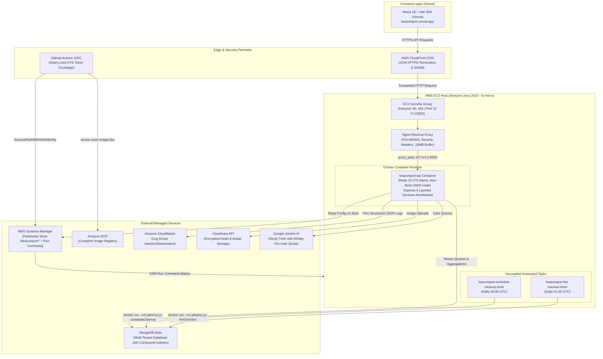
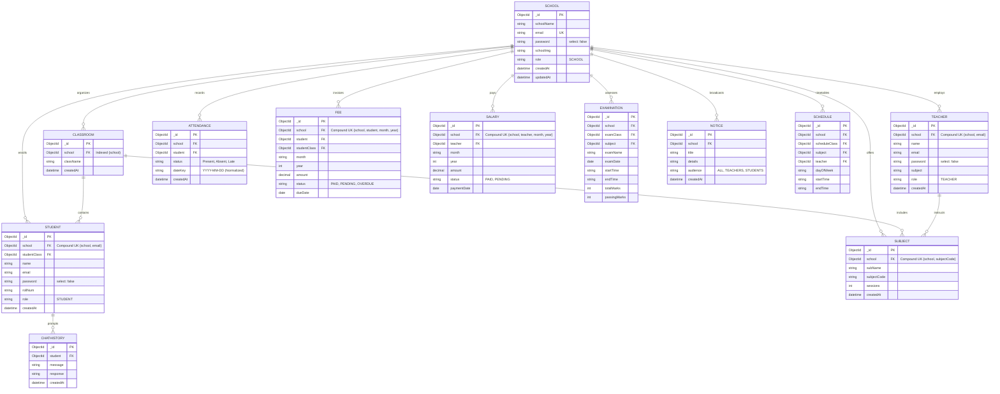

# BeaconPort: Multi-Tenant School Management Platform

[](https://github.com/Bhavdeep-Sai/BeaconPort/actions/workflows/ci.yml)
[](https://nodejs.org/)
[](https://expressjs.com/)
[](https://opensource.org/licenses/MIT)

BeaconPort is a production-grade, multi-tenant school management system engineered for high tenant isolation, observability, automated CI/CD, and zero-SSH cloud deployments. It provides administrative controls, academic scheduling, attendance tracking, fee invoicing, faculty payroll, and an AI study tutor powered by Google Gemini.

---

## Table of Contents
- [System Architecture](#system-architecture)
- [Entity-Relationship Diagram](#entity-relationship-diagram)
- [Multi-Tenant Isolation Architecture](#multi-tenant-isolation-architecture)
- [Roles & Permissions Matrix](#roles--permissions-matrix)
- [Technology Stack](#technology-stack)
- [Environment Variables](#environment-variables)
- [Local Development Setup](#local-development-setup)
- [Testing & Quality Assurance](#testing--quality-assurance)
- [Continuous Integration & Cloud Deployment](#continuous-integration--cloud-deployment)
- [Known Limitations & Architecture Decisions](#known-limitations--architecture-decisions)

---

## System Architecture

BeaconPort employs a **zero-SSH**, decoupled cloud architecture. Web traffic is routed through **AWS CloudFront** for global SSL/TLS termination and DDoS mitigation to an **Nginx** reverse proxy on an **Amazon EC2** host running containerized Express services. Background jobs are decoupled into host-level **systemd timers** executing ephemeral Docker containers, preventing resource contention with web traffic.



---

## Entity-Relationship Diagram

Every entity within BeaconPort is strictly partitioned by the school identifier (`school`). Compound indexes enforce tenant-scoped uniqueness (e.g. unique student email within a single school).



---

## Multi-Tenant Isolation Architecture

BeaconPort implements a **shared-database, logical tenant-isolation model**. In this model:
1. **Centralized Scoping (`withTenant`)**:
   All database read, update, and delete operations pass through `withTenant(filter, req)` defined in [`Server/utils/tenant.js`](file:///w:/Projects/BeaconPort/Server/utils/tenant.js). This ensures that `{ school: req.user.schoolId }` is injected into every query. If tenant context is missing from an authenticated request, `UnauthorizedError` is thrown immediately.
2. **Insecure Direct Object Reference (IDOR) Mitigation**:
   When querying resources by an `:id` parameter (such as `GET /api/student/single/:id` or `PUT /api/class/update/:id`), the query enforces both `_id: id` AND `school: req.user.schoolId`. If a user from School A requests a record belonging to School B, the query returns `404 Not Found` or `403 Forbidden`, preventing cross-tenant leakage.
3. **Compound Unique Indexes**:
   Unique constraints are scoped to the tenant. A student email `john@example.com` can exist in School A and School B simultaneously without conflict, but cannot be duplicated within School A (`{ school: 1, email: 1 }`).
4. **Automated Cross-Tenant Test Suite**:
   Every `:id` route has an automated test in [`Server/tests/crossTenant.test.js`](file:///w:/Projects/BeaconPort/Server/tests/crossTenant.test.js) proving that tenant boundaries cannot be breached.

---

## Roles & Permissions Matrix

BeaconPort enforces Role-Based Access Control (RBAC) across three principal actors: `SCHOOL` (Administrator), `TEACHER`, and `STUDENT`.

| Module & Capability | Endpoint Path | HTTP Method | `SCHOOL` (Admin) | `TEACHER` | `STUDENT` |
| :--- | :--- | :---: | :---: | :---: | :---: |
| **School Administration** | `/api/school/register`, `/login` | `POST` | Public | Public | Public |
| **School Profile Update** | `/api/school/update` | `PUT` | Full | No | No |
| **Faculty Directory** | `/api/teacher/all`, `/single/:id` | `GET` | Read | Read (Self) | Read (Assigned) |
| **Faculty Onboarding & Edit** | `/api/teacher/register`, `/update/:id` | `POST`/`PUT` | Full | No | No |
| **Student Directory** | `/api/student/all` | `GET` | Read (Paginated) | Read (Class) | No |
| **Student Registration** | `/api/student/register` | `POST` | Full | No | No |
| **Classroom Management** | `/api/class/create`, `/update/:id` | `POST`/`PUT` | Full | No | No |
| **Subject Assignment** | `/api/subject/create`, `/update/:id` | `POST`/`PUT` | Full | No | No |
| **Attendance Marking** | `/api/attendance/mark`, `/mark-bulk` | `POST` | Full | Full | No |
| **Attendance Analytics** | `/api/attendance/summary` | `GET` | Read | Read | Read (Self) |
| **Fee Billing & Upserts** | `/api/fee/bulk-generate`, `/create` | `POST` | Full | No | No |
| **Fee Invoices** | `/api/fee/student/:studentId` | `GET` | Read | No | Read (Self) |
| **Faculty Payroll** | `/api/salary/generate`, `/all` | `POST`/`GET` | Full | Read (Self) | No |
| **Exam Scheduling** | `/api/examination/create`, `/update/:id` | `POST`/`PUT` | Full | Full | Read |
| **Campus Notices** | `/api/notice/create`, `/delete/:id` | `POST`/`DELETE` | Full | Full | Read |
| **Timetable Management** | `/api/schedule/create`, `/update/:id` | `POST`/`PUT` | Full | Full | Read |
| **Gemini AI Study Tutor** | `/api/ai-tutor/chat` (50 queries/day) | `POST` | No | No | Full |
| **Health Probes** | `/health`, `/ready` | `GET` | Public | Public | Public |

---

## Technology Stack

| Layer | Technology | Version | Purpose & Architectural Justification |
| :--- | :--- | :--- | :--- |
| **Runtime** | Node.js | `v22.20.0` (Active LTS) | High-performance asynchronous event loop; LTS stability. |
| **Module System** | **CommonJS (`require`)** | Standard | Deterministic dependency resolution; no experimental ESM flags. |
| **Web Framework** | Express | `5.0.1` | Next-generation routing with native async error handling. |
| **ODM / Database** | Mongoose / MongoDB Atlas | `8.9.5` / `7.0` | Flexible schemas, compound indexing, atomic `bulkWrite` upserts. |
| **Validation** | Zod | `3.24.2` | Runtime schema validation for requests and startup environment checks. |
| **Observability** | Pino & Pino-HTTP | `9.6.0` / `10.4.0` | High-throughput structured JSON logging with `x-request-id` tracing. |
| **Security** | Helmet & Rate Limit | `8.0.0` / `7.5.0` | HTTP security headers and IP rate limiting (user enumeration defense). |
| **Containerization** | Docker & Compose | Multi-Stage | Node 22 Alpine, non-root `USER node`, dumb-init, health checks. |
| **CI/CD** | GitHub Actions | Workflows | Tests with coverage, npm audit, Gitleaks secret scan, OIDC CD. |
| **Cloud (IaC)** | Terraform | `>= 1.5.0` | Dedicated VPC, zero-SSH EC2, ECR, IAM OIDC, CloudWatch logs. |
| **Reverse Proxy** | Nginx | Stable | SSL termination, request ID propagation, 10MB body buffer. |
| **Frontend** | React 18 & Vite | `18.2.0` / `6.3.5` | Fast SPA client with Tailwind CSS and Material UI on Vercel. |

---

## Environment Variables

### Backend (`Server/.env`)
| Variable | Required | Type | Example / Description |
| :--- | :---: | :---: | :--- |
| `NODE_ENV` | Yes | String | `development`, `production`, or `test` |
| `PORT` | Yes | Number | Port on which the API listens (Default: `5000`) |
| `MONGO_URI` | Yes | Sensitive | MongoDB Atlas connection string (`mongodb+srv://...`) |
| `JWT_SECRET` | Yes | Sensitive | Cryptographic signing key (minimum 8 characters) |
| `FRONTEND_URL` | Yes | String | CORS allowlisted origin (e.g. `https://beaconport.vercel.app`) |
| `ENABLE_IN_PROCESS_CRON` | No | Boolean | `false` (Default; background jobs run via systemd timers) |
| `EMAIL_USER` | No | Sensitive | SMTP authentication username |
| `EMAIL_PASSWORD` | No | Sensitive | SMTP authentication password |
| `CLOUDINARY_CLOUD_NAME` | No | String | Cloudinary cloud account name |
| `CLOUDINARY_API_KEY` | No | Sensitive | Cloudinary API access key |
| `CLOUDINARY_API_SECRET` | No | Sensitive | Cloudinary API secret |
| `GEMINI_API_KEY` | No | Sensitive | Google Gemini API key for AI Study Tutor |

### Frontend (`Client/.env`)
| Variable | Required | Description |
| :--- | :---: | :--- |
| `VITE_BASE_API` | Yes | Base URL of the backend API (e.g. `https://d1234.cloudfront.net` or `http://localhost:5000`) |
| `VITE_GOOGLE_CLIENT_ID` | Yes | Google OAuth Web Client ID for Google Identity Services |

---

## Local Development Setup

### Option A: Local Multi-Container Development (Docker Compose)
Prerequisites: Docker Engine and Docker Compose.
```bash
# 1. Clone the repository
git clone https://github.com/Bhavdeep-Sai/BeaconPort.git
cd BeaconPort

# 2. Configure environment file from template
cp Server/.env.example Server/.env

# 3. Launch API and MongoDB 7.0 services with persistent storage
docker compose up --build

# 4. In a second terminal, launch the React client
cd Client
npm install
npm run dev
```

### Option B: Native Host Development
Prerequisites: Node.js 22 LTS and a running MongoDB instance (or local connection string).
```bash
# 1. Start Backend API
cd Server
npm install
cp .env.example .env
# Edit .env with your MONGO_URI and JWT_SECRET
npm run dev

# 2. Start Frontend Client (in a separate terminal)
cd Client
npm install
cp .env.example .env
npm run dev
```

Access the frontend at `http://localhost:5173` and the backend health probe at `http://localhost:5000/health`.

---

## Testing & Quality Assurance

BeaconPort features a comprehensive integration and unit test suite powered by **Jest**, **Supertest**, and **mongodb-memory-server**. Tests execute against an isolated in-memory database with zero external network or production dependencies.

### Running Test Suites
```bash
# Execute full backend test suite (8 test suites, 71 tests)
npm test --prefix Server

# Execute tests with coverage report
npm test --prefix Server -- --coverage

# Run database compound index migration audit
npm run migrate:indexes --prefix Server

# Run database query execution plan report (explain)
npm run explain:report --prefix Server

# Execute frontend production build check
npm run build --prefix Client
```

### Verified Test Results (Phase 6 Real Run)
```
PASS tests/auth.test.js (10.599 s)
PASS tests/architecture.test.js (5.144 s)
PASS tests/databaseDesign.test.js
PASS tests/passwordSanitization.test.js
PASS tests/crossTenant.test.js
PASS tests/aiTutor.test.js
PASS tests/redos.test.js
PASS tests/massAssignment.test.js

Test Suites: 8 passed, 8 total
Tests:       71 passed, 71 total
Snapshots:   0 total
Time:        38.291 s
```

---

## Continuous Integration & Cloud Deployment

### Continuous Integration (CI)
Every pull request and push to `main` triggers [`.github/workflows/ci.yml`](file:///w:/Projects/BeaconPort/.github/workflows/ci.yml):
1. **Backend Tests & Coverage**: Executes all 71 tests against MongoDB Memory Server and publishes coverage artifacts.
2. **Security Audit**: Scans dependencies with `npm audit --omit=dev --audit-level=high`.
3. **Secret Scanning**: Runs **Gitleaks** with full commit history to block committed credentials.
4. **Client Build**: Verifies the Vite production build (`npm run build`).
5. **Docker Build Check**: Builds `Server/Dockerfile` via Docker Buildx to prevent container build breakages.

### Continuous Deployment (CD)
After CI passes on `main`, [`.github/workflows/deploy.yml`](file:///w:/Projects/BeaconPort/.github/workflows/deploy.yml) performs a zero-SSH rollout:
1. **GitHub OIDC**: Authenticates to AWS via temporary STS token exchange (`sts:AssumeRoleWithWebIdentity`); zero static keys.
2. **Amazon ECR**: Builds and pushes Docker image tagged with commit SHA and `latest`.
3. **AWS Systems Manager (SSM) Run Command**: Dispatches a rollout command to the EC2 host. The SSM Agent pulls the new image, gracefully restarts the container, and verifies `GET /health`. Port 22 is **never opened**.

For the complete AWS step-by-step owner runbook, budget alarms, and teardown instructions, see [`docs/DEPLOY.md`](file:///w:/Projects/BeaconPort/docs/DEPLOY.md).

---

## Known Limitations & Architecture Decisions

For full Architecture Decision Records, see [`docs/DECISIONS.md`](file:///w:/Projects/BeaconPort/docs/DECISIONS.md).

1. **Currency Representation**:
   Fee amounts and salary compensation are currently stored as numeric floating values. In high-precision enterprise accounting, these should be migrated to integer minor units (e.g. cents/paise) to prevent IEEE 754 floating-point rounding errors.
2. **Horizontal Scaling & Rate Limiting**:
   API rate limiting (`express-rate-limit`) currently uses an in-memory store. When horizontally scaling the backend across multiple EC2 instances or ECS tasks behind an Application Load Balancer (ALB), rate limit tracking should be backed by a distributed Redis cluster (`rate-limit-redis`).
3. **Client-Side Refresh Tokens**:
   The React client currently stores JWT tokens in browser `localStorage`. A recommended security enhancement is migrating to short-lived access tokens with rotating refresh tokens delivered via `httpOnly`, `SameSite=Strict` cookies.
4. **Single-Node EC2 Architecture**:
   The current infrastructure is deployed to a single `t3.micro` EC2 instance, which qualifies for the AWS Free Tier ($0/month for months 1-12) and costs ~$9.39/month on-demand. High-availability multi-AZ failover would require an Application Load Balancer (ALB) and an Auto Scaling Group or AWS ECS Fargate cluster.
